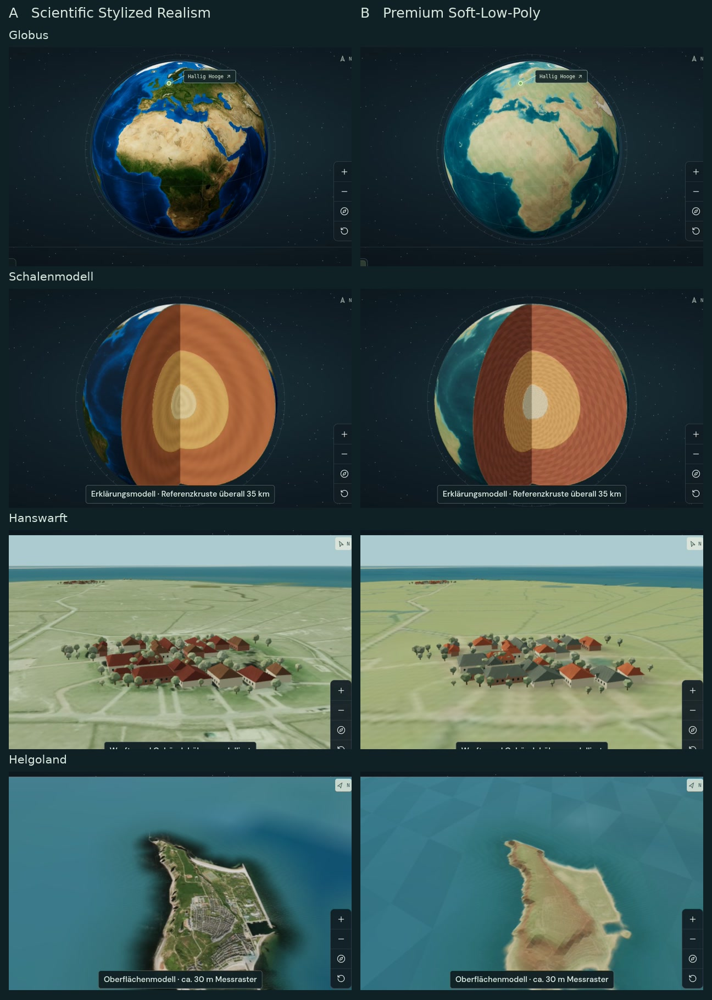

# GeoRisiko 3D · Korrekturprüfung G1.1

**Entscheidung.** Der technische Sockel ist als PR zur Prüfung bereit. Die vollständige Abnahme für den Unterricht ist offen. Die Messung zeigt einen praktikablen Weg zur Verringerung der Zeichenarbeit, zugleich aber weiterhin lange Bildabstände im Software-Rendering. Ein physisches Smartboard, die GPU eines Schulgeräts, Safari auf iPadOS und der schulische itslearning-Mandant standen für die Prüfung nicht zur Verfügung. [Pull Request 1](https://github.com/Feerson1617/Erdmodell/pull/1) · [CI-Prüfläufe und Pakete](https://github.com/Feerson1617/Erdmodell/pull/1/checks)

## Vergleich mit dem Ausgangspunkt

Referenz ist der gebaute Stand `34ffac7`. Beide Fassungen liefen nacheinander auf demselben Linux-Host mit AMD EPYC 9V74, Chromium 156.0.8078.79, ANGLE/Vulkan und SwiftShader. Je drei frische Seiten pro Stil, 1.366 × 768 CSS-Pixel, DPR 1, zwei Sekunden Ruhe vor dem ersten Ortsbesuch. Die Kennzahlen sind Mediane über drei Läufe. Für die Endpunkt-Bildrate wurden nach der Ankunft tatsächlich gezeichnete Frames drei Sekunden lang gezählt. Die separate Aufnahme belastet keinen dieser Messläufe.

| Kennzahl | A G1 | A G1.1 | B G1 | B G1.1 |
| --- | ---: | ---: | ---: | ---: |
| Bilder/s im Flug | 10,14 | 12,27 | 13,24 | 14,79 |
| 95. Perzentil Bildabstand (ms) | 439,5 | 341,6 | 246,8 | 227,5 |
| Längste Pause je Flug (ms) | 652,5 | 483,1 | 570,3 | 536 |
| Pausen über 250 ms je Flug | 6 | 7 | 4 | 4 |
| Browser-Renderer TaskDuration (ms) | 2695,17 | 2082,34 | 2434,54 | 1603,14 |
| GPU-Prozess, CPU-Sekunden | 22,22 | 22,17 | 21,77 | 23,22 |
| Bilder/s an der Hanswarft | 4,62 | 7,67 | 6,33 | 8,33 |
| Zeichenaufrufe an der Hanswarft | 58 | 26 | 58 | 26 |
| Dreiecke an der Hanswarft | 173468 | 65693 | 73850 | 42340 |
| GPU-Geometrien an der Hanswarft | 110 | 112 | 109 | 153 |
| GPU-Texturen an der Hanswarft | 5 | 7 | 6 | 9 |
| Zeichenauflösung am Ziel, Faktor | 0,75 | 0,75 | 0,75 | 0,75 |

`TaskDuration` summiert die Arbeit der Renderer-Tasks während des Flugs. Die CPU-Zeit des separaten GPU-Prozesses erfasst auch parallel arbeitende Software-Rasterizer-Threads und kann die reale Flugdauer übersteigen. Hardware-GPU-Auslastung, Grafikspeicher in Bytes und Fristtreue am Schulgerät sind offen. Die Three.js-Zähler beschreiben angelegte WebGL-Ressourcen. Ein Bildabstand von 300 ms bedeutet, dass der folgende visuelle Schritt etwa drei Zehntelsekunden auf sich warten ließ.

| Fokusabstand im Flug | A Dreiecke G1 → G1.1 | B Dreiecke G1 → G1.1 | A / B p95 Kachelverwaltung in G1.1 | A / B p95 Rendereraufruf in G1.1 |
| --- | ---: | ---: | ---: | ---: |
| Über 1.000 km | 58.128 → 56.784 | 27.408 → 27.408 | 4,6 / 1,9 ms | 1,0 / 1,1 ms |
| 10 bis 1.000 km | 32.064 → 21.504 | 9.888 → 7.680 | 4,4 / 4,4 ms | 191,1 / 146,2 ms |
| Unter 10 km | 175.196 → 67.229 | 74.534 → 42.784 | 1,9 / 2,5 ms | 254,7 / 228,5 ms |

Die Dreieckszahlen sind Mediane über die einzelnen Frames der jeweiligen Entfernungsstufe. Die im aufrufenden Thread gemessene Zeit für den Renderer enthält mögliche Wartezeiten auf den Treiber. Sie ist keine Messung der GPU-Shaderzeit. Der Referenzbuild instrumentierte diese beiden Abschnitte noch nicht.

Bei A stieg die mediane Anzahl der Pausen über 250 ms von sechs auf sieben, obwohl sich das 95. Perzentil verbesserte. Bei B stieg die CPU-Zeit des Grafikprozesses von 21,77 auf 23,22 Sekunden. Das ist ein messbarer Preis der Korrektur. Die drei korrigierten Läufe streuen zwischen A 11,4–12,3 Bilder/s und B 14,4–16,7 Bilder/s. Der GPU-Prozess bleibt mit der Rasterisierung beschäftigt. Die zusätzlichen Karten und wiederverwendbaren Darstellungen kosten Textur- und Geometriespeicher. Bei geringer Bildrate sinkt die Zeichenauflösung in beiden Fassungen auf bis zu 75 % je Achse, also rund 56 % der nativen Pixel. Kleine Gräben und Dachkanten werden dabei sichtbar weicher.

## Ursachen und Eingriffe

| Beobachtung bei G1 | Korrektur in G1.1 | Preis und verbleibende Grenze |
| --- | --- | --- |
| Das reguläre Hallignetz erzeugte viele Dreiecke über flachem Wasser. Gelände und Gebäudedarstellungen wurden beim Stilwechsel neu aufgebaut. | Das Netz entsteht offline. 6.340 Stützpunkte und 12.458 Dreiecke folgen Küste und Warften. Kompakte Indizes, gemeinsame Geländegeometrie, instanzierte Bäume und wiederverwendete Stilgruppen. Transparente Randdreiecke werden getrennt vom deckenden Kern gezeichnet. | Ein besuchter Ort hält seine Ressourcen im Speicher. Die erstmals benötigten Materialien und Bilder müssen weiterhin zum Grafiksystem übertragen werden. |
| Weltkacheln, geologische Geometrien und Schattenfenster verursachten Arbeit während der Fahrt. | Einfachere Beleuchtung des Globus, Horizonttest, 3-ms-Budget für neue Kacheln, sichtbare Eltern bis zum fertigen Quartett, Kachelcaches pro Stil. Der Schalenaufbau wird im aktiven Erdschnitt aktualisiert, Sichtbarkeit und Deckkraft ändern vorhandene Materialien. Das lokale Schattenfenster folgt diskreten Positionen. | Ein einzelnes Netz oder eine erstmalige Shader-Kompilierung kann das Budget überschreiten. Ein vollständig neuer Schalentyp oder Schnitt löst weiterhin einen Aufbau aus. |
| Zwischen grobem Weltbild und Hallig fehlten lesbare Zwischenmaßstäbe. Dunst färbte den Anflug fast vollständig ein. | Nordwesteuropa-Komposit, WorldCover-Landbedeckung, regionales Orthofoto, lokales Halligbild und Hanswarftdetail. Kamera zentriert früher auf den Zielraum. Die Nebeldichte ist distanzabhängig begrenzt. Rechteckige Ausschnitte werden an Datenrändern und vor der Küste ausgeblendet. | Bei starkem Zoom wechseln Satellitenkomposit, Klassenfarben und Luftbild sichtbar ihren Charakter. Dünne Landstreifen, Tidenstände und die Aufnahmefarben stimmen zwischen den Quellen nur näherungsweise überein. |
| Kamera, lokales Netz und Modelle setzten Hooge voraus. | Beide Standorte durchlaufen dieselbe Lade-, Projektions-, Kamera- und Renderlogik. Helgoland und Düne stammen aus einem gemessenen Oberflächenmodell mit 22.545 Stützpunkten. Ortswahl, Übersicht, Nahziel und Fehlerpfad wurden in beiden Browsern benutzt. | Der Teststandort hat keine separaten Gebäudemodelle. Für größere oder höher gelegene neue Untersuchungsräume sind örtliche Bezugsebene und Randanschluss zu validieren. [Regionsvertrag](architecture-decision.md) |
| Fachtext, Deckkraft und didaktische Überhöhung waren aus Unterrichtsdistanz schwer zuzuordnen. | Grundtext und Vertiefung trennen Beobachtung und Schlussfolgerung. P- und S-Wellen, indirekte Messung, feste Referenzkruste und Lithosphäre sind erläutert. Die Unterrichtskarte lässt sich ein- und ausblenden und durch die Schichten blättern. Der Maßstabshinweis bleibt sichtbar. | Die Prüfung kontrolliert Schrift, Touchziele, Kontrast im Screenshot und Layout. Die tatsächliche Lesedistanz und das Verständnis einer heterogenen neunten Klasse erfordern eine Unterrichtserprobung. [Unterrichtsansicht](evidence/g11/unterricht.jpg) |

## Sichtprüfung



| Vergleich mit festem Blickpunkt | Beobachtung |
| --- | --- |
| Erde, 18° N / 19° O | A zeigt blaue Ozeane, Wüsten und fotografische Strukturen. B betont flache Schelfmeere und Hochländer mit Türkis-, Sand- und Ockertönen. Beide Silhouetten bleiben gut lesbar. Die Facetten von B sind auf weiten Wasserflächen deutlicher sichtbar. |
| Erdschnitt, gleiche Radien und Schnittstellung | A zeigt weicher verlaufende Bänder. In B heben sich der rostfarbene Mantel, der goldene äußere Kern und der hellere innere Kern als jeweils eigene Flächen ab. Die Dreiecksstruktur ist in der großen Mantelfläche regelmäßig erkennbar. |
| Hanswarft, 290 m Fokusabstand | In A sind Feldstrukturen, Wege und Dachgruppen dichter lesbar. In B treten polygonale Kronen, größere Dachüberstände, Giebel und eine ruhigere Flächenkarte hervor. Gleiche Grundrisse und Warftform ermöglichen den direkten Vergleich. B verliert feine Grabendetails. Luftbildschatten und Modellschatten fallen in A örtlich auseinander. |
| Helgoland | A zeigt Siedlungsstruktur und Hafenkanten im Luftbild. B hebt Hochfläche und Kliffrand durch Höhenfarben hervor. Die geglättete Kliffkante und die angenäherte Küstenwasserfarbe sind im Nahbild erkennbar. |

Das Urteil zur Eigenständigkeit beruht auf Form, Material, Licht und Informationsgehalt dieser Bildpaare. Die automatisierte Bilddifferenz dient nur zur Erkennung einer wirkungslosen Stilumschaltung.

### Die Fahrt als Bildfolge

Die MP4-Dateien enthalten in zeitlicher Reihenfolge die von Chromium gelieferten Bildschirmbilder. CDP forderte jedes Bild an. Lücken behalten ihre Dauer im 25-Hz-Video. Es wurden keine Zwischenbilder synthetisiert. Für die Sichtung standen die ganze Fahrt, zeitlich gleichmäßig verteilte Einzelbilder und die stärksten Helligkeitswechsel zur Verfügung. Die Kameradaten der Aufnahme werden den auffälligen Zeitpunkten über die gemeinsame Uhr zugeordnet. Unter Last können mehrere Animationsschritte auf ein geliefertes Bild fallen.

Die Referenz lieferte 54 bzw. 70 Bilder. Bei A wirkte die Bildmitte um 3,5 s weitgehend einfarbig. Die Korrekturfassung lieferte 73 Bilder in 7,07 s für A und 86 Bilder in 7,45 s für B. In beiden korrigierten Aufnahmen gab es keine nahezu einfarbige 64 × 40-Helligkeitsprobe. Die längsten Abstände zwischen gelieferten Bildern betrugen 500 und 334 ms, in der Referenz 533 und 534 ms. Zwischen gehaltenen Bildern kann die Ansicht weiterhin sichtbar springen.

Im Mittelteil werden erst die nordfriesische Küstenlinie und die Inselgruppe, dann die Hallig und schließlich Wege, Gräben und Hausgruppen lesbar. Die geradlinigen Ausschnittkanten früherer Zwischenstände sind zurückgedrängt. Zwischen Wasserfarbe des Küstenkomposits, generalisierter Landbedeckung und dem örtlichen Luftbild bleibt ein Farbübergang erkennbar. B vereinfacht Wege und Nebenarme stärker. Der größte mittlere Helligkeitssprung im Bildausschnitt lag bei A bei 14,5 %, bei B bei 14,5 % des Dynamikbereichs. Kamerabewegung, DOM-Wechsel, Quellwechsel und die Zeitlücke können gemeinsam dazu beitragen. Aus dem Einzelwert lässt sich keine eindeutige Ursache ableiten.

- Referenzaufnahmen und Zeitreihen liegen für [A](evidence/g11/referenz/flug-A.mp4) und [B](evidence/g11/referenz/flug-B.mp4) vor.
- Die Korrekturfassung ist als [Flug A](evidence/g11/kandidat/flug-A.mp4) und [Flug B](evidence/g11/kandidat/flug-B.mp4) abrufbar.
- Die [Bildfolge A](evidence/g11/kandidat/filmstreifen-A.jpg) und [Bildfolge B](evidence/g11/kandidat/filmstreifen-B.jpg) zeigen denselben räumlichen Weg. [Rohprofile G1](evidence/g11/referenz/profil.json) · [Rohprofile G1.1](evidence/g11/kandidat/profil.json)

## Regressionen und Reproduktion

`npm test` prüft die lokalen Datennetze auf endliche Höhen, Indexgrenzen, Orientierung, entartete Dreiecke, vollständige Flächenabdeckung und offene Innenkanten. Für Helgoland werden Kollisionsraster und dargestellte Höhen verglichen. Beide Browser prüfen Rotation, Radzoom, Rücksetzen, Schnitt, Schichtauswahl, Transparenz samt Wiederherstellung, unterbrechbare Hin- und Rückfahrt sowie den Wechsel zwischen beiden Regionen. Die Ausfalltests blockieren Bilder und Ortsdaten und liefern absichtlich eine beschädigte Binärdatei. Der Fallback bleibt bedienbar. Der frühere Architekturprototyp wird getrennt mit vier gerenderten Farbproben geprüft.

Der Zwei-Minuten-Wechseltest erfasst bei jeder abgeschlossenen Rundreise Geometrien, Texturen und Shaderprogramme, in Chromium zusätzlich den gemeldeten JavaScript-Heap. Die Prüfung vergleicht den wiedererreichten warmen Zustand mit dem Ende der Serie. Die Rohzahlen der beiden Browser stehen im Prüfarbeitsprodukt unter `results.json → runs → soak`. Ein stabiler Zähler über diesen Zeitraum erlaubt keine Aussage über einen ganzen Schultag. Chromium und Linux-WebKit bilden zusätzlich ein Touch-Tablet im Quer- und Hochformat ab. Der Chromium-Test nutzt dreifache CPU-Drosselung und sendet Zwei-Finger-Ereignisse.

Der Workflow prüft alle Ressourcen über HTTP unter `/Erdmodell/`. Anschließend entpackt er die beiden erzeugten ZIPs und startet sie im Iframe unter `/lms/kurse/erde/`. Der Pakettest besucht Erdschnitt, Hallig und Helgoland, prüft HTTP-Fehler und im SCORM-Paket die Aufrufe von `LMSInitialize` und `LMSFinish`. Die Sichtprüfung enthält die tatsächlichen CI-Aufnahmen unter `Pruefung/audit/`. Die mitgelieferten Belege unter `Pruefung/evidence/g11/` stammen aus dem hier verglichenen Cloud-Lauf.

Für eine Wiederholung von `34ffac7` einen separaten Checkout bauen. Den Audit-Treiber aus G1.1 auf beide Produktionsverzeichnisse anwenden. Derselbe Chromium-Browser, Viewport, Auflösungsfaktor, Rendering-Backend und ruhende Host sind für den Vergleich wesentlich. Keine Browserprüfungen parallel zum Zeitprofil starten.

```sh
node tests/flight-audit.mjs /pfad/zur/referenz/dist /tmp/g1
python3 scripts/analyse_flight.py /tmp/g1
npm run build
npm run audit
python3 scripts/compare_profiles.py /tmp/g1/profil.json test-results/audit/profil.json
node tests/gate.mjs
npm test
python3 scripts/compare_views.py
npm run package
node tests/packages.mjs
```

Die Farblogik und Messgenauigkeit jeder Detailstufe sind getrennt nachgewiesen. Fachliche Quellen, Höhenreferenzen und Schalengrenzen stehen in der Fachdokumentation. [Geodaten und Lizenzen](g1.1-data.md) · [Geowissenschaftliche Grundlagen](geoscience-validation.md)
