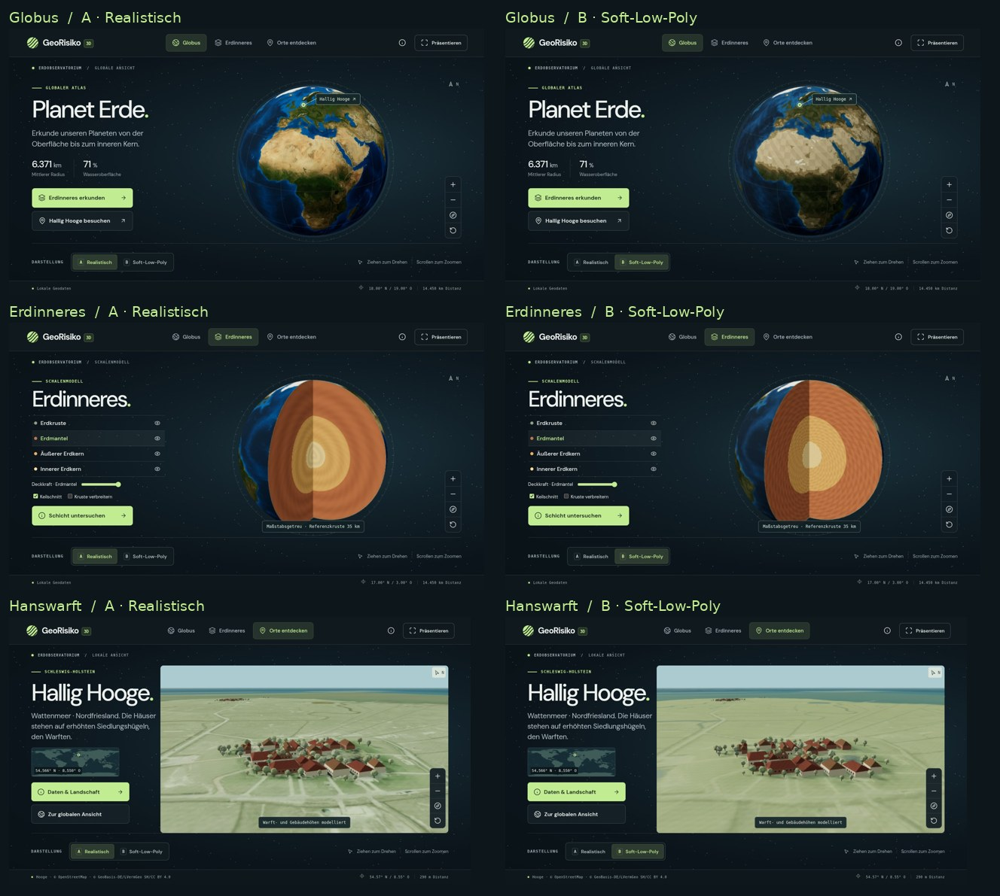

# G1 · Prüf- und Übergabebericht

**Der Sockel läuft in Chromium und WebKit.** Die Browser haben den Produktionsbuild unter `/Erdmodell/` geöffnet, Renderbilder ausgewertet, Eingaben ausgelöst und beide Entfernungsrichtungen durchlaufen. Für die schulische Freigabe fehlen Praxismessungen am Zielgerät und der Import in den itslearning-Mandanten.

## Prüfaufbau

Messlauf am 2026-11-18. Linux x86-64 im Cloud-Container, AMD EPYC 9V74 80-Core Processor, CPU-Quote vier Kerne und 32 GiB Speichergrenze. Chromium 156.0.8078.79 mit SwiftShader, WebKit 26.0 im Linux-WPE-Minibrowser. WebKits Rendererkennung „Apple GPU“ ist die gemeldete Zeichenkette, kein Beleg für Apple-Hardware. Die Messungen enthalten den Aufwand der Browserautomation einschließlich Bildschirmaufnahmen.

Chromium bestand 13, WebKit 12 Prüfgruppen. Darunter sind Bildvergleiche für Stilwechsel, Schichten, Transparenz und Schnitt, Zurücksetzen, Unterbrechen einer Kamerafahrt, Hin- und Rückflug in A/B sowie Navigation nach absichtlich fehlgeschlagenen Datenabrufen. Farbstreuung im tatsächlichen Canvas ist eine zusätzliche Kontrolle gegen eine leere Szene. Kein JavaScript-, Netzwerk- oder Konsolenfehler im regulären Hauptlauf. Fehlerfälle werden in getrennten Browserkontexten ausgelöst. Im Prüf-ZIP stehen die Ladepfade, Statuscodes, Konsolenmeldungen und Kamera-Zeitreihen in `Pruefung/`. [Protokoll dieses Builds](evidence/browsertests.json)

## Bildrate und Speicher

Momentwerte der über kurze Zeitfenster gezählten Bilder pro Sekunde. Globus und erste beide Halligwerte bei 1366 × 768, Tablet bei 1024 × 768. Im Chromium-Tablettest ist die CPU dreifach gedrosselt.

| Browser | Hooge A | Hooge B | Globus A | Tablet Hooge A | Bis zur gerenderten Prüfbereitschaft |
| --- | ---: | ---: | ---: | ---: | ---: |
| Chromium | 4,2 | 5,8 | 4,8 | 2,5 | 1,9 s |
| WebKit | 17,1 | 25,4 | 37,8 | 17,8 | 2,8 s |

Die Zielgröße von 30 FPS ist auf MacBook Air M1 und Smartboard noch zu messen. Im Cloud-Lauf wurde sie nicht zuverlässig erreicht. Bei niedriger Bildrate reduziert sich die interne Auflösung. Beim Vergleich der lokalen Ansichten lagen in Chromium 173,468 Dreiecke für A und 73,850 für B vor. Bei der Rückkehr zum Globus nach wiederholten Stilwechseln meldete der Renderer 34 Geometrien und 7 Texturen. Geladene Ortsbilder bleiben für einen erneuten Anflug im Cache. Das sind Objektzähler; eine Messung der GPU-Bytes oder ein Langzeit-Speichertest steht aus.

## Visuelle Prüfung und Navigation

- **Globus:** Die Lichtseite zeigt Kontinente, Gebirge und Meeresrelief im Bild. A erleichtert das Erkennen natürlicher Oberflächen. B zeigt die großen Formen und Facetten ruhiger; im Weltmaßstab sind einzelne Facetten klein.
- **Erdinneres:** Der mitdrehende Keil hat zwei unterschiedlich beleuchtete Flächen. Bei korrektem Bezug ist die Kruste fast eine Haarlinie. Bei Überhöhung bleibt der Hinweis im Bild. Sichtbarkeit, Auswahl und Deckkraft sind einzeln steuerbar. Transparente Oberflächen können je nach Blickwinkel überlagert erscheinen.
- **Hooge:** Das Orthofoto in A macht das Entwässerungsmuster lesbar. Die Hausdächer, Baumgruppen und vereinfachten Warften sind Volumen. B reduziert die Fotozeichnung zugunsten der Gebäude- und Geländeformen. Lokale Vegetation, Profilhöhen und Gebäude bleiben erkennbar Modelle. Die Kartentextur hat eine endliche Auflösung; bodennahe Perspektiven erlauben keine Gebäudevermessung.
- **Flug:** Start bei 14.450 km Fokusabstand, Ende bei 290 m über einer schrägen Sichtlinie. Die Entfernung nahm in beiden vollständigen Anflügen monoton ab. Chromium erfasste 70 / 89 Zwischenbilder (A/B), WebKit 181 / 210. Kameraposition und Norden bleiben im gemeinsamen Bezug. Regionaler Detailgewinn ist erkennbar. Der größte Abstand zwischen zwei aufgezeichneten Zwischenbildern lag bei 855 ms. Die Fahrt hat keinen programmierten Szenenschnitt, kann auf diesem System aber sichtbar stocken.
- **Bedienung:** Desktop 1366 × 768, Infoansicht 1920 × 1080, Tablet quer 1024 × 768 und hoch 768 × 1024 geprüft. Die Schrift der Fachinformationen ist in der Smartboard-Auflösung groß; die Statustexte sind für die Lehrkraft am Gerät ausgelegt. Der Dialog überdeckt einen Teil der Welt und lässt sich wieder schließen. Abstandstest im Klassenraum, reale Stiftbedienung und physisches iPad-Safari sind offen.
- **Fehlerbehandlung:** Die lokale Basiskarte ersetzt das fehlende große Erdbild. Bei fehlenden Hooge-Daten zeigt die Anwendung den Fehler, stellt die regionale Küste ein und erlaubt die Rückkehr. Die Anwendung verwendet beim Laden der Szene keine externen Geodatendienste.

Die zehn Original-Screenshots im Sichtprüfungs-ZIP umfassen zusätzlich den laufenden Flug, die Smartboard-Infoansicht und beide Tabletformate. Einzelbilder allein weisen weder Flackerfreiheit über alle Blickwinkel noch ruckelfreies Rendering auf Schulhardware nach.

## Abnahme und Einsatzgrenzen

| Gate | Nachweis | Stand |
| --- | --- | --- |
| A · Architektur | Technischer WebGL-Versuch, eine Kamera, zwei vollständige Browserstrecken je Engine, Architekturentscheidung | Technisch nachgewiesen |
| B · Gestaltung | Sechs unmittelbar vergleichbare Bilder, Keilgeometrie, Material- und Netzvarianten, lokales Luftbild | Visuell geprüft. Abnahme des bevorzugten Stils durch die Lehrkraft offen |
| C · Fachlichkeit und Bedienung | Quellen, echte Ortslagen, getrennte Maßstabsmodi, Touch und Fehlerfälle | In den genannten Browsern geprüft. Physische Unterrichtserprobung offen |
| D · Veröffentlichung und Reproduzierbarkeit | Lockfile-Build, SCORM-Manifest, Paketstart im lokalen Test-LMS, Sichtprüfungs-ZIP und Git-Übergabe | Lokale Übergabe. Pages ist separat freizugeben, itslearning separat zu testen |

GitHub meldete für das Repository `has_pages: false`. Der Workflow ermöglicht eine spätere Freigabe über GitHub Actions auf `main`. Ein PR-Build führt die Prüfungen aus; die Pages-Veröffentlichung ist eine gesonderte manuelle Aktion. Die Produktversion erfasst keine Antworten, Noten oder Schülerstände. Das LMS kann einen Kursaufruf seinerseits protokollieren.
